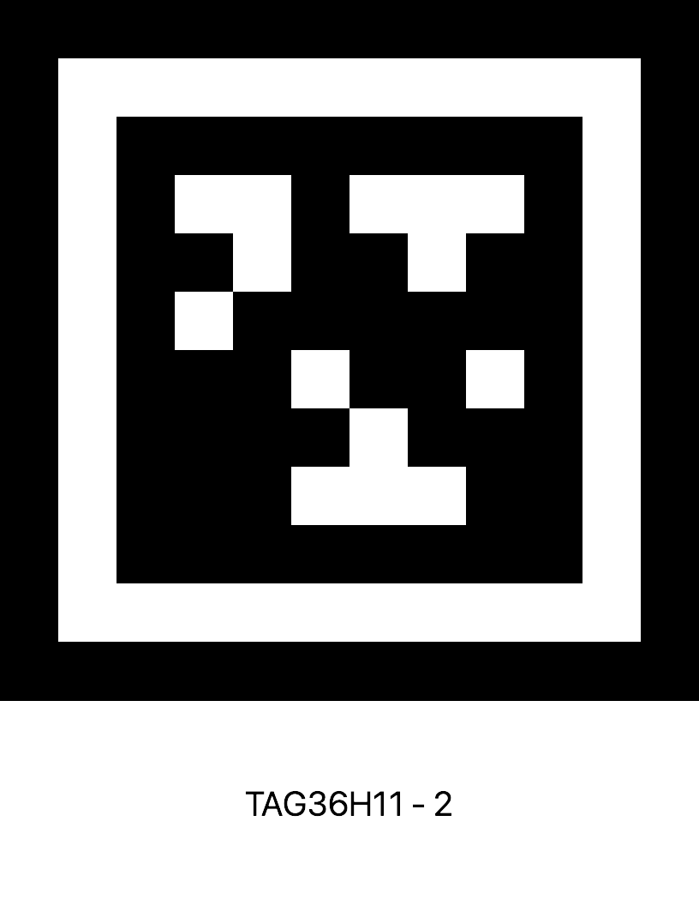

# TME 441 Milestone 2

Arduino sketch for navigating a robot between AprilTags using a HuskyLens camera.
The program searches for tags 1 through 3, approaches each tag, and repeats.

This solution works reasonably well, as long as the tags are well-lit and close
enough to the robot. But under non-ideal conditions, the robot periodically
loses sight of the tag, or overshoots the angle and misses the tag entirely.

Your task is to test this solution, discover its limitations, and then redesign
it to be more robust and reliable.

Refer to the online [HuskyLens documentation](https://wiki.dfrobot.com/sen0305)
for libraries and tutorials for the camera.

## Files

- `tme441-milestone-2.ino`: sketch entry point and HuskyLens setup.
- `camera.ino`: camera queries and tag distance estimation.
- `navigation.ino`: tag search, alignment, and approach logic.

## Requirements

- An Arduino board with `Serial3` (such as an Arduino Mega).
- A HuskyLens camera connected over serial and configured for **Tag Recognition** with the serial protocol set to **9600**.
- The Arduino `Encoder`, `Servo`, and `HuskyLens` libraries.
- Your own `driving.ino` and `motor_control.h` files. They are not included in this repository; the sketch expects motor functions such as `initMotors()`, `driveDistance()`, and `rotateCCW()`.

## Instructions

### Mount and connect the HuskyLens.

1. Remove the HuskyLens from its packaging and install it in the protective silicone case.
2. Mount the HuskyLens to your robot using the provided hardware and nylon screws. See the example robot for details.
3. Plug in the provided cable to the UART/I2C port and connect the wires.
   - Connect the power and ground wires to the +5V supply rails on your breadboard.
   - Connect the TX and RX wires to pins 14 and 15 on your Arduino.

### Learn April Tags and test tag recognition.

1. Follow the instructions in [Section 10 of the documentation](https://wiki.dfrobot.com/sen0305/docs/22646) to put the HuskyLens into Tag Recognition mode.
2. Point the HuskyLens at your monitor and register the tags below as ID=1, ID=2, and ID=3, respectively.
3. Verify that the HuskyLens recognizes the tags correctly and displays their bounding boxes on the LCD screen.

| Tag 1 | Tag 2 | Tag 3 |
| ----- | ----- | ----- |
 |  |  |

### Install the HUSKYLENS library

1. Download the [HUSKYLENS library from GitHub.](https://github.com/HuskyLens/HUSKYLENSArduino)
2. Place the HUSKYLENS folder in your Arduino libraries directory ([How do I find my libraries folder?](https://support.arduino.cc/hc/en-us/articles/4415103213714-Find-sketches-libraries-board-cores-and-other-files-on-your-computer))

### Test the Milestone 2 Solution

1. Download or clone this repository to your own computer.
2. Copy your own driving.ino and motor_control.h files into the tme441-milestone-2 sketch folder.
3. Upload the code and test it on your own robot.
